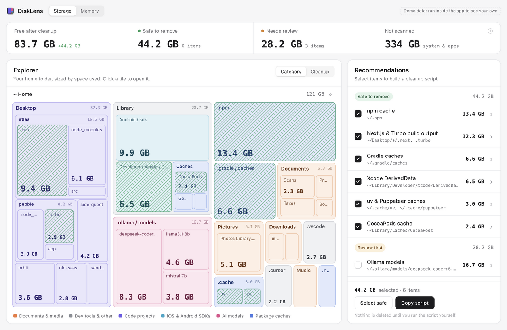
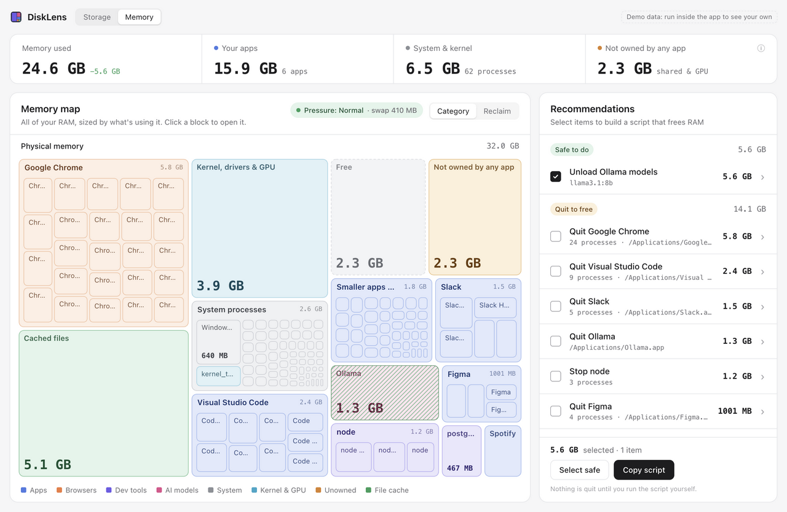

# DiskLens

**See where your disk space and RAM actually go.** A small desktop app for macOS, Windows and Linux.

Most tools show you a "System Data" or "Other" bar you can't open, or RAM numbers that don't add up. DiskLens shows all of it as a map you can click into, explains the parts no other tool explains, and builds a cleanup script you can read before you run it.





<sub>Screenshots use the built-in demo data.</sub>

## What it does

### Storage
- **A map of your home folder (or the whole disk)**, sized by the space files actually take on disk, hidden files included. Click any block to zoom in.
- **Colored by what it is:** documents and media, code projects, iOS and Android SDKs, AI models, package caches, and everything else.
- **Cleanup recommendations**, split into *Safe to remove* (caches and build output that tools recreate on their own) and *Review first* (things that cost a re-download or might hold work). They include npm/pnpm/Yarn/Bun caches, Gradle, Maven, Cargo, Go, CocoaPods, pip, Xcode DerivedData, Next.js/Turbo build output, Rust `target/` folders, `node_modules` in projects you haven't touched in 30 days, Ollama/LM Studio/Hugging Face models (shown by model name), Android SDKs, simulators, Docker, installers in Downloads, and more.
- **A "Not scanned" breakdown**, so the space no scan can see (the OS itself, other users, snapshots, protected folders) is accounted for instead of silently missing.

### Memory
- **A map of all your RAM:** every app with its helper processes grouped together, system processes, kernel and GPU memory, file cache, and free memory.
- **"Not owned by any app":** the RAM that's in use but billed to no process (GPU buffers, window surfaces, shared memory). It's usually why the per-app numbers don't add up to "Memory used".
- **Memory pressure**, the number that actually tells you whether you need more RAM.
- **Recommendations:** unload idle Ollama models, or quit/stop the apps using the most memory.

### Nothing is deleted or quit by the app
Every recommendation becomes a plain shell script (bash on macOS and Linux, PowerShell on Windows). **Copy script** puts it on your clipboard; you read it, then run it yourself. The app only ever reads.

## Installing

Download the file for your system from the [latest release](https://github.com/Duke242/disklens/releases/latest).

These builds aren't signed with paid Apple/Microsoft developer certificates yet, so your OS will warn you the first time:

- **macOS:** open the `.dmg` and drag DiskLens to Applications. If macOS says the app "is damaged" or "can't be opened", run this once in Terminal, then open it again:
  ```sh
  xattr -dr com.apple.quarantine /Applications/DiskLens.app
  ```
  To include Mail, Messages, Safari and other apps' data in a scan, add DiskLens under **System Settings ▸ Privacy & Security ▸ Full Disk Access** (the app shows a button for this).
- **Windows:** run the `-setup.exe`. If SmartScreen says "Windows protected your PC", click **More info ▸ Run anyway**.
- **Linux:** use the `.deb` or `.rpm`, or make the `.AppImage` executable (`chmod +x DiskLens_*.AppImage`) and run it.

## What it can measure on each OS

| | macOS | Linux | Windows |
|---|---|---|---|
| Disk sizes | Actual allocated space | Actual allocated space | File sizes |
| Hard links counted once | ✓ | ✓ | |
| Per-app memory | Footprint (matches Activity Monitor), all users | Private (anonymous) memory, all users | Working set |
| Kernel / wired memory | ✓ (includes GPU) | ✓ (slab, page tables, stacks) | |
| File cache | ✓ | ✓ | |
| GPU memory | ✓ (Apple Silicon) | | |
| Memory pressure | ✓ | ✓ (PSI) | |

On Windows, per-process numbers include memory shared between processes, so they can add up to *more* than what's used. The app says so when that happens.

## Privacy

DiskLens never sends anything anywhere. Its only network request goes to `localhost:11434`, to ask a locally running Ollama which models it has loaded.

## Building from source

You'll need [Node.js](https://nodejs.org) 22+, [Rust](https://rustup.rs), and the [Tauri prerequisites](https://tauri.app/start/prerequisites/) for your OS.

```sh
npm install
npm run tauri dev      # run the app
npm run tauri build    # build an installer for your OS
npm run dev            # UI only, in a browser, with demo data
cd src-tauri && cargo test
```

The Rust backend (`src-tauri/src`) does the scanning and reads memory statistics (`storage/`, `memory/`). The React UI is in `src/`. Cleanup rules for each OS live in `src-tauri/src/storage/rules.rs`; contributions for tools and paths it doesn't know yet are welcome.

## License

[MIT](LICENSE)
